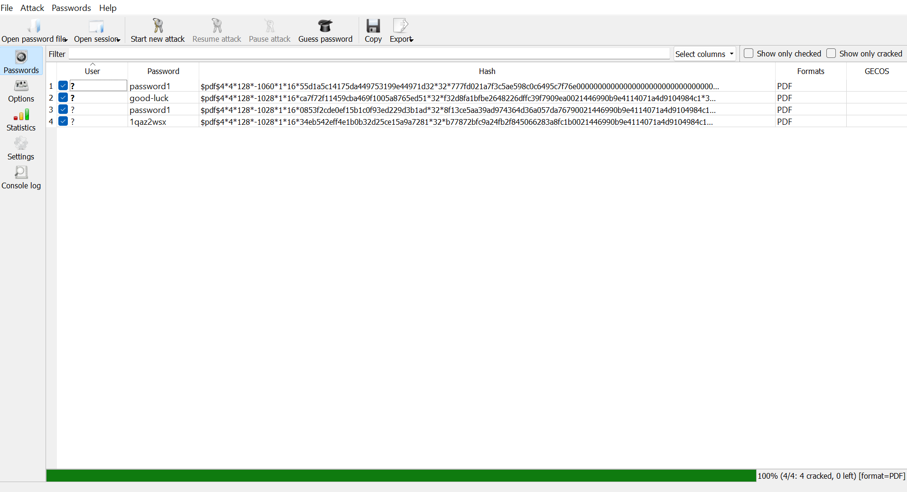
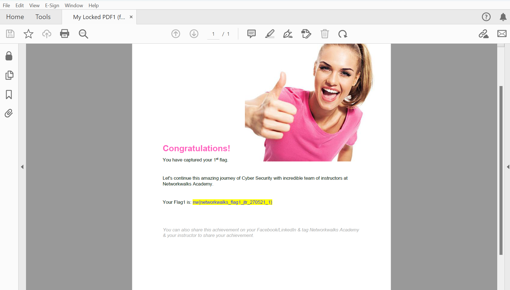
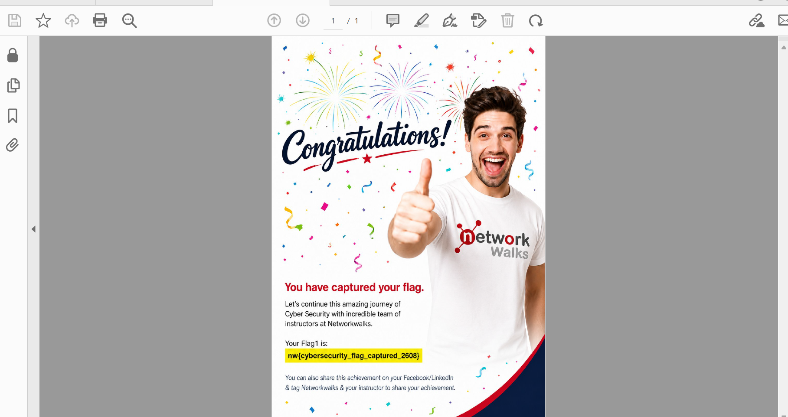
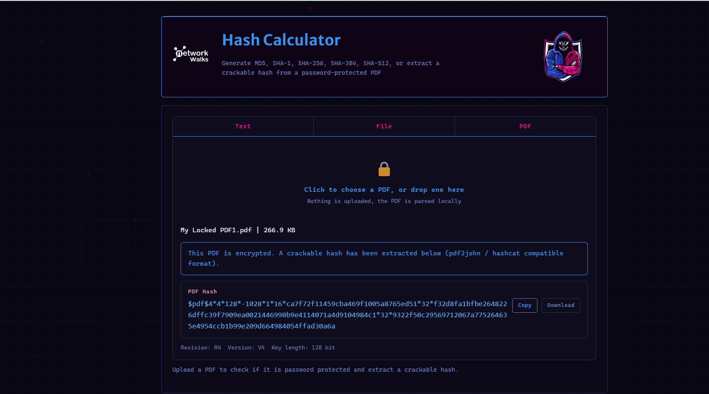
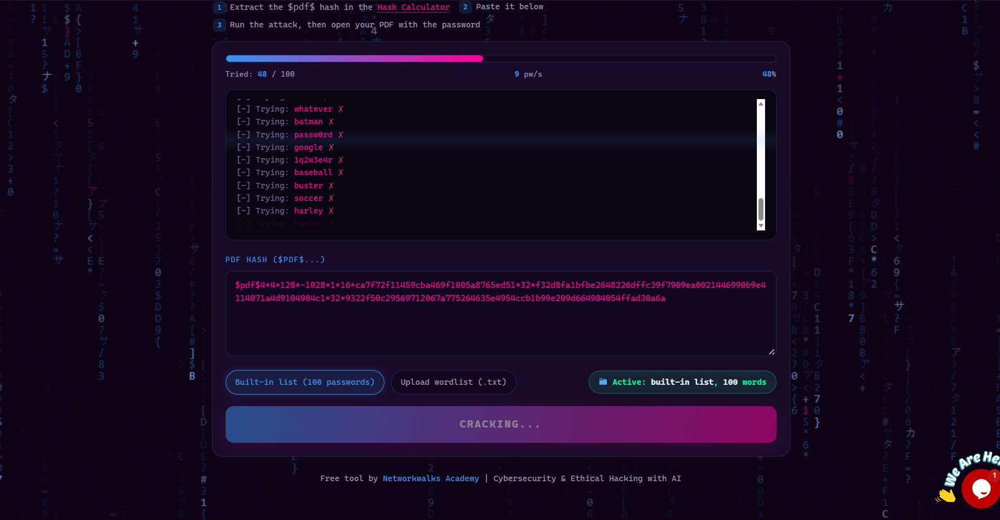
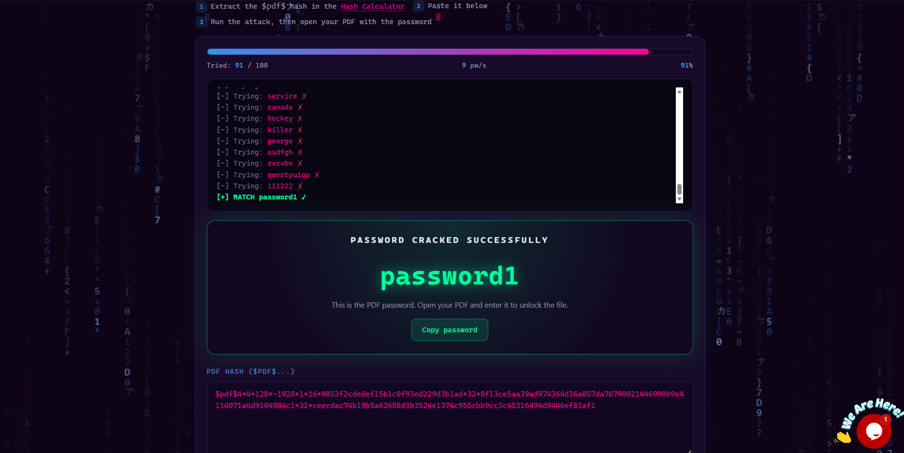
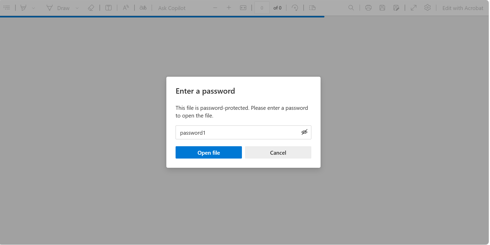
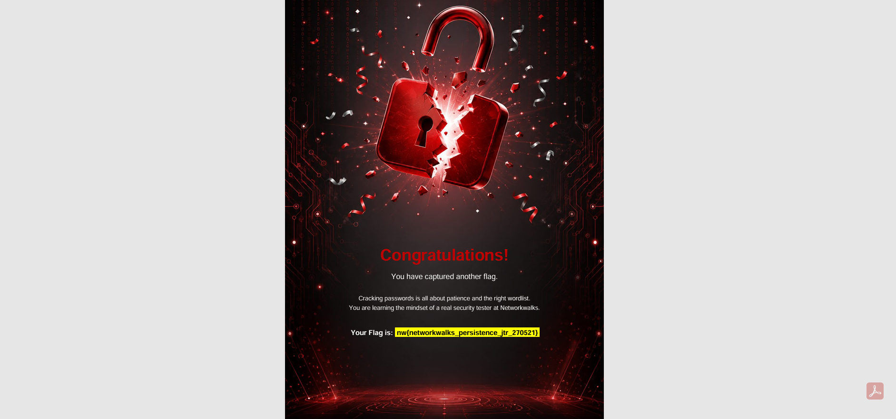

<h1 align="center">PENETRATION TESTING REPORT</h1>

<h3 align="center">PASSWORD CRACKING WITH JTR &amp; NETWORKWALKS TOOLS</h3>

W3-PM-FINAL | CYBERSECURITY | NETWORKWALKS

| **Report field** | **Details** |
|---|---|
| **Pentester Name (Cybersecurity Professional)** | Anzadakalo Kenneth Mulaudzi |
| **Program/Batch** | B084N-Networkwalks |
| **Date** | 23 November 2026 |
| **Modules completed** | W3-PM1 (Password Cracking with JTR) W3-PM2 (Password Cracking with NW Tools) |
| **Client/Target** | 1. Networkwalks lab files: four password-protected PDFs supplied for the Week 3 practical |
| **Permission secured from client?** | Yes (lab files supplied by Networkwalks for this assignment) |
| **Phases covered** | **Phase 3:** Gaining Access (offline password recovery) **Phases 1, 2, 4 and 5:** Not in scope for these modules |

## 1. Liability Disclaimer

I have performed these activities only on the password-protected files supplied by Networkwalks for this practical. All these materials are for education and research purposes only. Do not use anything from here to break the law. The instructor, the authors and Networkwalks are not responsible for what you do with this knowledge. Every action you take is your own responsibility. Misuse can lead to criminal charges, heavy fines, loss of your job and a permanent record. In most countries unauthorised access is a crime even when nothing is damaged.

## 2. Introduction

This report covers the two essential modules of Week 3 of my Cybersecurity & Ethical Hacking program at Networkwalks. **W3-PM1** recovers PDF passwords with John the Ripper (JTR) and its graphical front end, Johnny. **W3-PM2** repeats the exercise with the Networkwalks Hash Calculator and Password Cracker, which run in the browser. Both modules are required and both are covered here. The two optional Week 3 labs are not included.

Password cracking belongs to the gaining-access phase of an assessment. A locked PDF does not store its password in plain text. It stores a derived verification value, a hash, which is checked against the password the user types. To recover the password, the hash is extracted from the file and tested against candidate passwords, usually from a wordlist, until one matches. These modules show how little protection a weak password provides, even when the file itself is properly encrypted.

Each finding below records what I did, the result I observed, the screenshot that supports it and why it matters from an attacker’s point of view. Figures are referenced in the text and collected in Section 8.

## 3. Tools Used

The table below lists each tool used in this report and its purpose.

| **Tool** | **Purpose** |
|---|---|
| **Windows PC** | Operating system used for the JTR and Johnny work and for opening the recovered PDFs. |
| **John the Ripper (`john.exe`)** | Offline password cracker. Tests candidate passwords against the hash extracted from a PDF. |
| **Johnny (JTR GUI)** | Graphical front end for John the Ripper. Loads hash files, starts attacks and shows cracked results. |
| **Networkwalks Hash Calculator** | Browser tool that reads an encrypted PDF and produces a crackable `$pdf$` hash. Its page states that the file is parsed locally and not uploaded. |
| **Networkwalks Password Cracker** | Browser tool that runs a dictionary attack on a PDF hash, using a built-in 100-password list or an uploaded wordlist. |
| **Adobe Acrobat Reader and Microsoft Edge** | PDF viewers used to open the locked files with the recovered password. |

## 4. Activities Performed

### Password Cracking with John the Ripper and Johnny (W3-PM1)

The W3-PM1 task was to recover the password of `My Locked PDF1.pdf` using John the Ripper (JTR John) and Johnny on my Windows PC. I installed Johnny, set its John path to `john.exe` in the JTR run folder, extracted the `$pdf$` hash from the PDF, saved it as `hash1.txt`, loaded that file with **Open password file** and selected **Start new attack**.

Johnny finished with every hash cracked (Figure 1). Four PDF hashes were loaded into that session: the NW Tools copy of the file, and PDF1, PDF2 and PDF3. The recovered passwords are listed below.

| **File** | **Recovered password** |
|---|---|
| My Locked PDF1 (for NW Tools Lab WK3-PM2).pdf | `password1` |
| My Locked PDF1.pdf | `good-luck` |
| My Locked PDF2.pdf | `password1` |
| My Locked PDF3.pdf | `1qaz2wsx` |

The NW Tools copy opened with `password1`, and the viewer showed the first flag (Figure 2). A further flag capture is shown in Figure 3. The file name is not visible in that screenshot.

This session shows the core weakness clearly. All four files fell in one session, and the passwords are common: a common word with a digit added (`password1`), a common phrase (`good-luck`) and a keyboard pattern (`1qaz2wsx`). An attacker who has a copy of a locked file can extract its hash, test guesses offline at the speed of their own machine, and face no account lockout or alert.

### Password Cracking with Networkwalks Tools (W3-PM2)

The W3-PM2 task repeated the exercise with two browser tools. I selected `My Locked PDF1.pdf` in the Hash Calculator. The tool reported that the PDF is encrypted, produced a crackable hash in pdf2john and hashcat format, and identified the encryption as Revision R4, Version V4 with a 128-bit key (Figure 4). The page states that nothing is uploaded and the PDF is parsed locally.

I copied the complete hash into the Password Cracker and ran it with the built-in list of 100 passwords. When captured, the attack was at 48 of 100 candidates, running at 9 passwords per second, with no match yet (Figure 5). The screenshots do not show that run finishing. The password for this file had already been recovered with John the Ripper: `good-luck` (Figure 1).

I then cracked the hash from `My Locked PDF2.pdf`. The Password Cracker found a match with `password1` after 91 of 100 candidates (Figure 6). At the displayed rate of 9 passwords per second, that is roughly ten seconds of work. I entered `password1` into the PDF viewer (Figure 7), and the file opened to show the flag in Figure 8.

**A note on file versions.** The PM2 brief names `My Locked PDF1.pdf` but then tells the reader to enter `password1`. That password opens the separate NW Tools copy, `My Locked PDF1 (for NW Tools Lab WK3-PM2).pdf`, but it does not open `My Locked PDF1.pdf`. The two PDFs have different hashes and passwords, so the result depends on which copy is loaded. Checking the file name before cracking avoids confusion.

The built-in list is short, so this tool only finds passwords that appear in it. A password chosen outside common lists would be safer from this tool, though not from a determined attacker with a larger list.

## 5. Risk Analysis / Impact

Based on the results of both modules, I identified the following risks. Each row gives the evidence for the finding, its potential impact and my risk rating.

| **#** | **Risk / Finding** | **Evidence / Observation** | **Potential Impact** | **Risk Level** |
|:-:|---|---|---|:-:|
| 1 | **Weak, common passwords protect the files** | Johnny recovered all four passwords in one session. The web cracker matched `password1` after 91 candidates (Figures 1 and 6). | Anyone with a copy of a file can open it within minutes. The encryption offers little real protection. | 🔴 **Critical** |
| 2 | **Same password used on two files** | `password1` opened two different PDFs (Figure 1). | Cracking one password exposes every file that shares it. | 🟠 **Medium** |
| 3 | **Password hashes can be extracted and tested offline** | The Networkwalks Hash Calculator produced a crackable hash from an encrypted PDF (Figure 4). Johnny cracked four such hashes (Figure 1). | An attacker can test guesses at local speed, with no lockout, rate limit or alert. | 🟠 **Medium** |
| 4 | **Older PDF encryption configuration** | The files use Revision 4 with a 128-bit key and an AES-128 cipher (Figure 4). | AES-256 with PDF 2.0 is the current stronger option. The password, not the cipher, is the weak point exploited here. | 🟡 **Low** |
| 5 | **Protected files sent to third-party tools** | The PM1 instructions direct learners to an online hash extractor that requires uploading the locked PDF. The Networkwalks calculator states that files are parsed locally (Figure 4). | Uploading a confidential protected file to an outside site may expose its contents and hash to parties the owner did not approve. | 🟠 **Medium** |

**Risk level key:**  🔴 Critical  🟠 Medium  🟡 Low

The risks above are observations from the two password-cracking modules, not confirmed vulnerabilities in a live system. The lab files were protected with deliberately simple passwords, so these results show how easily that protection can be defeated.

The practical was limited to recovering passwords from files supplied for the assignment. No live system, network or account was accessed, and the findings should not be read as a statement about any production environment.

The value of these findings is in the method and the lesson. A password that is common, short or reused gives little protection, whatever the strength of the encryption behind it.

## 6. Recommendations

Based on the observations from these modules, I recommend the following security improvements:

1. **Use long, unique passwords for protected files** Use at least 12 characters. A passphrase of unrelated words, or a random string generated by a password manager, is far harder to guess than a single dictionary word. Length makes dictionary attacks much less effective.
2. **Avoid common words, phrases and patterns** `password1` is a common word with a digit added, `good-luck` is a common phrase and `1qaz2wsx` is a keyboard pattern. All three are the kind of password that appears on widely circulated lists of common passwords. Adding a digit or symbol to a common word does not make it strong.
3. **Do not reuse passwords across files** Each protected document should have its own password. `password1` protected two files in this practical, so cracking one exposed the other.
4. **Use AES-256 encryption for PDFs** The files here use Revision 4 with a 128-bit key and AES-128 (Figure 4). PDF 2.0 with AES-256 is the stronger option and is available in current PDF tools such as Adobe Acrobat.
5. **Screen passwords against known weak lists** NIST SP 800-63B recommends checking passwords against lists of commonly used and breached passwords, with a minimum length, rather than relying on arbitrary composition rules. Organisations should apply this to every password they set or accept.
6. **Keep protected documents off third-party tools** Use tools that run locally for hash extraction, or read a tool’s privacy statement before uploading anything confidential. The Networkwalks Hash Calculator, which parses files locally, is the better pattern.
7. **Treat hashes and recovered passwords as sensitive** Redact hashes and passwords from screenshots and reports before sharing them. Any real credential exposed this way should be changed immediately.
8. **Test only with authorisation** Use only files and systems that you own or have written permission to test. Keep lab material separate from real client or personal data.

## 7. Conclusion

During Week 3 of my Cybersecurity & Ethical Hacking program at Networkwalks, I completed both required modules. In W3-PM1 I used John the Ripper and Johnny on Windows to recover the passwords for all four lab PDFs in one session. In W3-PM2 I used the Networkwalks Hash Calculator and Password Cracker in the browser to extract a hash and recover `password1` for a second file.

The screenshots show three flags captured from the recovered files (Figures 2, 3 and 8).

The most useful lesson was about passwords rather than tools. JTR and the web cracker both succeeded because the passwords were common. Encryption is only as strong as the password that protects it, and in this practical one weak password protected two different files.

I also learned to choose tools carefully. The browser tool that parses files locally avoids uploading protected files, while the online hash extractor suggested in the PM1 instructions requires an upload. Good practice is to check where a file goes before using any third-party service.

Finally, these exercises stayed within authorisation. All files were supplied by Networkwalks for this assignment, and nothing outside the supplied lab material was tested.

## 8. Evidences Collected

The eight screenshots below are the evidence for the activities in Section 4. Each is captioned with its figure number and the time recorded in its file name.

**Figure 1.** Johnny session with four PDF hashes loaded and cracked, 4 of 4 (20 Nov 2026, 13:23).

**Figure 2.** Flag 1 (`nw{networkwalks_flag1_jtr_270521_1}`) from My Locked PDF1 (for NW Tools Lab WK3-PM2), opened with `password1` (20 Nov 2026, 13:18).

**Figure 3.** Further flag capture (`nw{cybersecurity_flag_captured_2608}`). The file name is not visible in the screenshot (20 Nov 2026, 13:24).

**Figure 4.** Networkwalks Hash Calculator output for My Locked PDF1.pdf: Revision R4, Version V4, 128-bit key (23 Nov 2026, 09:21).

**Figure 5.** Networkwalks Password Cracker running against the PDF1 hash, 48 of 100 tried, no match yet (23 Nov 2026, 09:22).

**Figure 6.** Networkwalks Password Cracker match for My Locked PDF2.pdf: `password1` after 91 of 100 candidates (23 Nov 2026, 09:23).

**Figure 7.** PDF password prompt with `password1` entered (23 Nov 2026, 09:24).

**Figure 8.** Flag captured after opening the file: `nw{networkwalks_persistence_jtr_270521}` (23 Nov 2026, 09:24).

<b>-End-</b>

**👤 Author** 
**Anzadakalo Kenneth Mulaudzi** 
Cybersecurity Professional, B084N

**📌 Project Information** 
**Program Name:** Cybersecurity program at Networkwalks | **Week:** 03 | **Repository:** GitHub

---

## Repository contents

| Path | What it is |
|---|---|
| `README.md` | This report, in Markdown, with the evidence embedded |
| `report/W3-PM-FINAL_-_Password_Cracking_Report.docx` | Editable Word version of the report, built on the Networkwalks template |
| `report/W3-PM-FINAL_-_Password_Cracking_Report.pdf` | PDF version of the report |
| `evidence/` | The eight screenshots referenced as Figures 1 to 8 |
